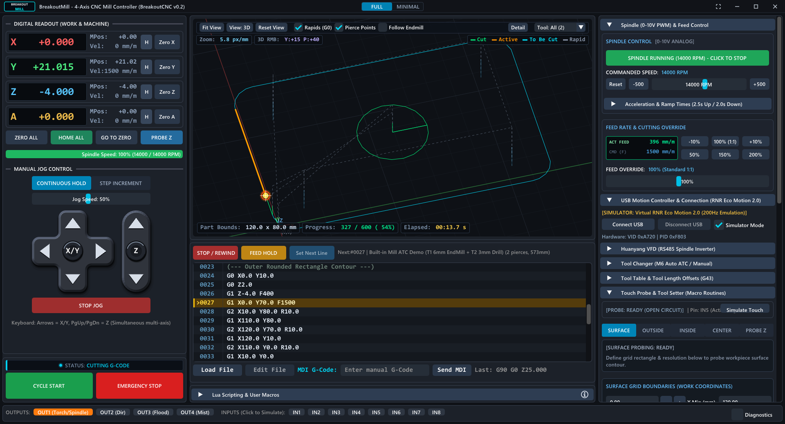
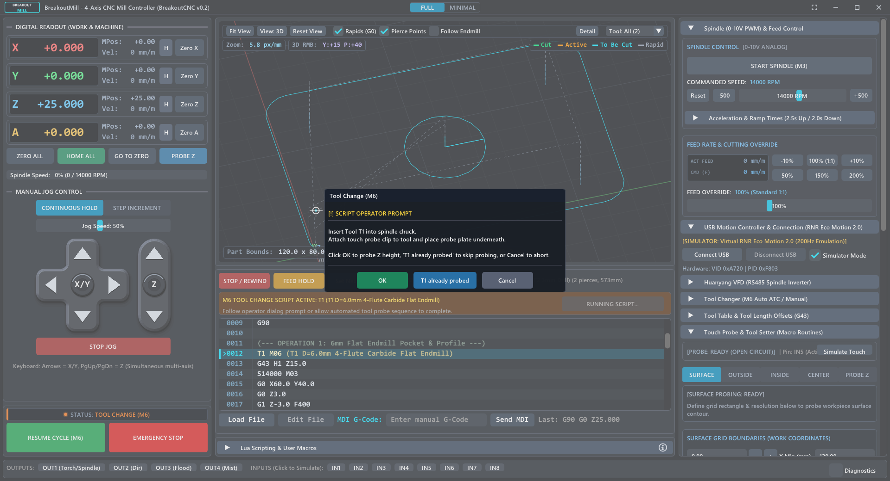
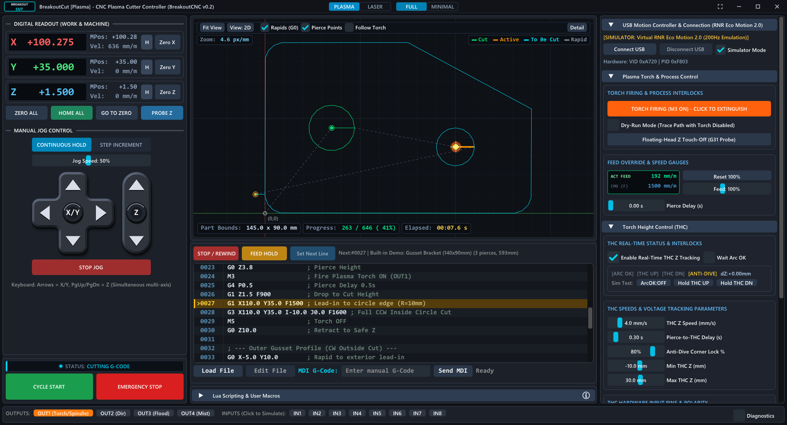
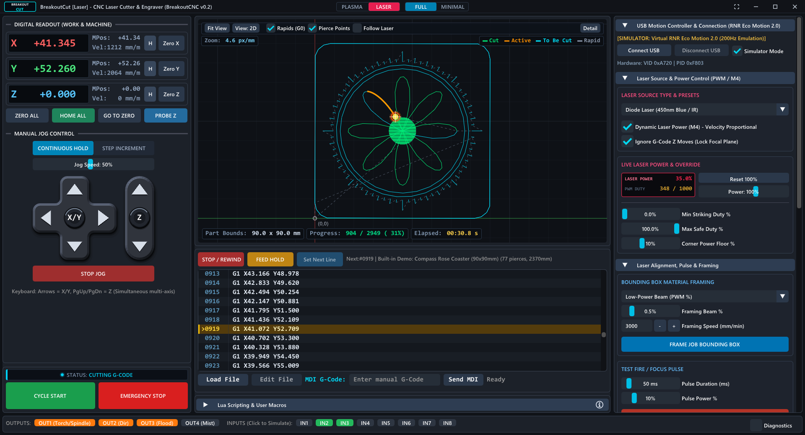

# BreakoutCNC

[](https://github.com/rolanddd-hu/BreakoutCNC/actions/workflows/ci.yml)
[](LICENSE)

Open-source PC control software for hobby CNC machines. The two applications are:

- **BreakoutMill**: a 4-axis mill / router controller (X, Y, Z, A).
- **BreakoutCut**: a plasma and laser cutter controller with torch height control.

BreakoutCNC drives the **RNR Eco Motion 2.0** USB motion board (VID `A720`, PID `F803`, the red/blue STM32 board sold
as a Mach3 USB controller). The PC plans the motion and streams it to the board, so the board's original
Mach3 plugin is not needed. A built-in simulator lets you try everything without hardware.

> **Experimental.** This is an early release (see the [changelog](CHANGELOG.md)). Read the [safety notice](#safety) before
> connecting it to a machine.



## Features

- G-code parser and look-ahead trajectory planner, feed hold / resume, feed and spindle overrides, MDI.
- Work offsets G54-G59, G92, G53, G28 / G30, tool table with tool length offsets.
- Homing, soft limits, E-Stop and limit handling, gantry slaving of the A axis to X or Y.
- Probing: Z touch-off, edge / corner / bore / boss / slot / web probing scripts, height-map surface probing with
  toolpath warping.
- Huanyang VFD spindle control over RS-485 (Modbus), with speed monitoring and reading limits.
- Plasma: torch height control (THC), initial height sensing. Laser: PWM power, M4 dynamic (speed-proportional) power, framing, air assist.
- Lua 5.4 scripting (`cnc.*` API): M6 tool change, homing, macro buttons and custom M-codes
  ([scripts/](scripts/), [SCRIPTING_ENGINE_SPEC.md](docs/architecture/SCRIPTING_ENGINE_SPEC.md)).
- Mach3 profile import: motor tuning, homing, limits, slaving, spindle, RNR and Huanyang VFD plugin settings.
- Camera view with a toolpath overlay and an optional MJPEG stream for remote monitoring.
- 2D / 3D toolpath view.

## Screenshots

All screenshots were taken in the built-in simulator, with the demo programs that come with the apps.

**M6 tool change.** The tool change is a Lua script ([scripts/mill/m6.lua](scripts/mill/m6.lua)) that pauses the job and asks the operator
to insert the tool, then probes its length or skips probing.



**BreakoutCut, plasma mode.** The torch is firing on an inside circle cut. The right panel shows the torch
height control (THC) status and tracking settings.



**BreakoutCut, laser mode.** The laser demo: a coaster with a raster-filled center, an engraved rose, rings and
compass ticks, then the outline cut. Laser power follows the speed (M4 dynamic power). The right panel has the
power limits, job framing and a test pulse; the chiller and door interlocks (IN2 / IN3) must be closed before the
laser can fire.



## Status

| Area | State |
|---|---|
| BreakoutMill with the RNR board | Tested against the board on the bench; not yet run on a real machine |
| BreakoutCut: plasma and laser | Simulator only, **not tested on a real cutting machine** |
| Huanyang VFD | Protocol tested in unit tests; parameter read-back not yet checked on a real VFD |
| Windows 10 / 11 (x64) | Main platform |
| Linux / macOS | Build instructions below, but **not yet built or tested**. The camera works on Windows and Linux |
| Other motion boards | Not supported yet; the driver layer is prepared ([BOARD_DRIVERS.md](docs/architecture/BOARD_DRIVERS.md)) |

## Building

All platforms need CMake 3.22 or newer, Git, a C++20 compiler and an internet connection for the first configure
(CMake downloads Dear ImGui, GLFW and Lua, plus hidapi on Linux / macOS).

### Windows

Requirements: Visual Studio 2022 with "Desktop development with C++".

```powershell
cmake -B build -G "Visual Studio 17 2022" -A x64
cmake --build build --config Release
```

The applications end up in `build/Release/` (`BreakoutMill.exe`, `BreakoutCut.exe`) together with the `scripts/` and
`resources/` folders they need. Settings are saved next to the executables (`breakout_mill_settings.ini`,
`breakout_cut_settings.ini`).

### Linux (untested)

Install a compiler (GCC 11+ or Clang 14+) and the GLFW, OpenGL and USB HID development packages.

Debian / Ubuntu:

```bash
sudo apt install build-essential cmake git pkg-config libx11-dev libxrandr-dev libxinerama-dev libxcursor-dev libxi-dev libwayland-dev libxkbcommon-dev wayland-protocols libgl-dev libudev-dev libusb-1.0-0-dev
```

Fedora:

```bash
sudo dnf install gcc-c++ cmake git pkgconf-pkg-config libX11-devel libXrandr-devel libXinerama-devel libXcursor-devel libXi-devel wayland-devel libxkbcommon-devel wayland-protocols-devel mesa-libGL-devel systemd-devel libusb1-devel
```

Build and run (the applications look for `scripts/` and `resources/` in the current directory, so start them from
`build/`):

```bash
cmake -B build -DCMAKE_BUILD_TYPE=Release
cmake --build build -j
cd build && ./BreakoutMill
```

To use the RNR board without root, allow access to its HID device with a udev rule, then unplug and replug the
board:

```bash
echo 'SUBSYSTEM=="hidraw", ATTRS{idVendor}=="a720", ATTRS{idProduct}=="f803", MODE="0660", TAG+="uaccess"' | sudo tee /etc/udev/rules.d/70-rnr-eco-motion.rules
```

```bash
sudo udevadm control --reload-rules
```

For the Huanyang VFD, your user needs access to the USB RS-485 adapter (`/dev/ttyUSB0` or similar). Add yourself
to the `dialout` group (`uucp` on Arch), then log out and back in:

```bash
sudo usermod -aG dialout $USER
```

The file dialogs use `zenity` (GNOME) or `kdialog` (KDE); install one of them if neither is present.

### macOS (untested)

Install the Xcode command line tools and CMake (for example with [Homebrew](https://brew.sh)):

```bash
xcode-select --install
```

```bash
brew install cmake
```

Build and run from `build/`:

```bash
cmake -B build -DCMAKE_BUILD_TYPE=Release
cmake --build build -j
cd build && ./BreakoutMill
```

The board needs no driver on macOS. USB RS-485 adapters for the Huanyang VFD show up as `/dev/cu.usbserial-...`;
some (CH340) need the vendor's driver on older macOS versions. The camera view is not available on macOS yet.

### Version

The version number is set in one place: `project(VERSION ...)` in [CMakeLists.txt](CMakeLists.txt).

### Release package (Windows)

```powershell
cmake --build build --config Release --target package
```

This creates `build/BreakoutCNC-<version>-win64.zip` with the two applications, `scripts/`, `resources/icons/`, the
README, license, changelog, third-party notices and the hardware validation checklist. Test and diagnostic
executables, settings files and build libraries are not included. The C++ runtime is linked statically, so the zip
runs on a clean Windows 10 / 11 PC without the Visual C++ Redistributable.

### Publishing a release

1. Set the new version in `project(VERSION ...)` in [CMakeLists.txt](CMakeLists.txt) and add a `## <version>` section
   to [CHANGELOG.md](CHANGELOG.md).
2. Commit and push, then push a matching tag:

```bash
git tag v0.1
```

```bash
git push origin v0.1
```

The [release workflow](.github/workflows/release.yml) then builds and tests on Windows and publishes a GitHub Release
named "BreakoutCNC <version>" with the zip attached and the changelog section as release notes. It stops without
publishing if the tag does not match the CMake version or the changelog has no section for it.

## Tests

```powershell
build\Release\script_engine_test.exe
build\Release\huanyang_vfd_test.exe
```

On Linux / macOS: `build/script_engine_test` and `build/huanyang_vfd_test`.

GitHub Actions ([.github/workflows/ci.yml](.github/workflows/ci.yml)) builds and runs both tests on Windows, Linux and
macOS for every push and pull request. The Windows run also builds the release zip and attaches it to the run as
`BreakoutCNC-win64`.

Both run without hardware. `rnr_hid_test.exe` is a hardware diagnostic tool, **not** a unit test: it talks to a
connected board and sends it the reset / arm sequence. Only run it with the stepper drivers powered off and the
applications closed.

## Safety

CNC machines, plasma torches and lasers can injure or kill. This software is provided without any warranty.

- Always have a **hardwired E-Stop** that cuts power to the drivers and spindle / torch / laser. The software E-Stop
  is only a second layer.
- Work through [docs/HARDWARE_VALIDATION_CHECKLIST.md](docs/HARDWARE_VALIDATION_CHECKLIST.md) with the drivers off
  before moving a real machine.
- Test new jobs in the simulator first, and run them in the air before cutting material.

## Documentation

- [docs/architecture/BOARD_DRIVERS.md](docs/architecture/BOARD_DRIVERS.md): machine core vs. board drivers, how to add
  a board.
- [docs/architecture/SCRIPTING_ENGINE_SPEC.md](docs/architecture/SCRIPTING_ENGINE_SPEC.md): Lua scripting API.
- [docs/protocol/PROTOCOL_SPEC.md](docs/protocol/PROTOCOL_SPEC.md): RNR Eco Motion 2.0 USB protocol.
- [docs/protocol/HUANYANG_VFD_PROTOCOL.md](docs/protocol/HUANYANG_VFD_PROTOCOL.md): Huanyang VFD protocol and Mach3
  plugin settings.
- [AGENTS.md](AGENTS.md): UI and coding rules (also used by AI coding assistants).
- [CHANGELOG.md](CHANGELOG.md), [THIRD_PARTY_NOTICES.md](THIRD_PARTY_NOTICES.md).

## License

BreakoutCNC is free software: you can redistribute it and/or modify it under the terms of the
[GNU General Public License version 3](LICENSE), or (at your option) any later version. It is distributed in the
hope that it will be useful, but WITHOUT ANY WARRANTY; without even the implied warranty of MERCHANTABILITY or
FITNESS FOR A PARTICULAR PURPOSE.

The libraries it uses (Dear ImGui, GLFW, Lua, hidapi) are under their own GPL-compatible licenses, see
[THIRD_PARTY_NOTICES.md](THIRD_PARTY_NOTICES.md).

RNR, Mach3 and Huanyang are trademarks of their owners. BreakoutCNC is not affiliated with them.
