# BreakoutCNC User Guide

This guide takes you from download to running a job: installing the apps, trying them in the simulator, setting up a
new machine (or importing it from Mach3), and day-to-day use of BreakoutMill and BreakoutCut.

> **Safety first.** BreakoutCNC is experimental software. Always have a **hardwired E-stop** that cuts power to the
> stepper drivers and the spindle / torch / laser; the software E-stop is only a second layer. Test every new setup
> with the drivers powered off first ([hardware validation checklist](HARDWARE_VALIDATION_CHECKLIST.md)), then at low
> speed with a hand on the E-stop, and run new jobs in the air before cutting material.

## Contents

1. [What you need](#1-what-you-need)
2. [Install and first start](#2-install-and-first-start)
3. [The main window](#3-the-main-window)
4. [Try it in the simulator](#4-try-it-in-the-simulator)
5. [Set up a new machine](#5-set-up-a-new-machine)
6. [Migrate from Mach3](#6-migrate-from-mach3)
7. [Run a job](#7-run-a-job)
8. [Probing](#8-probing)
9. [BreakoutCut: plasma and laser](#9-breakoutcut-plasma-and-laser)
10. [Scripts and macros](#10-scripts-and-macros)
11. [Remote monitoring](#11-remote-monitoring)
12. [Troubleshooting and getting help](#12-troubleshooting-and-getting-help)

---

## 1. What you need

- A **RNR Eco Motion 2.0** USB motion board (the red / blue STM32 "Mach3 USB" board, USB ID `A720:F803`). No other
  motion boards are supported yet. Without a board, everything runs in the built-in simulator.
- A PC with Windows 10 / 11 (main platform), Linux or macOS. OpenGL 3.3 graphics is required; any GPU from the
  last ten years, including integrated graphics, is enough.
- Optional: a Huanyang VFD on a USB RS-485 adapter, a touch plate / tool setter, a camera.

Pick the app for your machine:

| App | Machine |
|---|---|
| **BreakoutMill** | Mill / router with X, Y, Z and an optional A axis (rotary, or a second gantry motor) |
| **BreakoutCut** | Plasma cutter with torch height control, or laser cutter / engraver (switch with PLASMA / LASER in the title bar) |

## 2. Install and first start

Download the package for your system from the [Releases](https://github.com/rolanddd-hu/BreakoutCNC/releases) page
and unpack it into a folder you can write to (the settings are saved there):

- **Windows:** unzip and run `BreakoutMill.exe` or `BreakoutCut.exe`. Windows may show a SmartScreen warning because
  the apps are not signed: choose "More info" → "Run anyway".
- **Linux:** unpack and run `./BreakoutMill` or `./BreakoutCut`. To use the board without root, add the udev rule
  from the [README](../README.md#linux-untested); for the VFD, add yourself to the `dialout` group.
- **macOS:** unpack, then run `xattr -dr com.apple.quarantine <folder>` once (or right-click an app and choose Open).

On every start:

- The app looks for the board. If it finds one, it connects and configures it; otherwise it runs in the **simulator**.
- The machine starts in **E-stop**. Nothing moves until you press **RESET E-STOP**.
- The last loaded program is opened again (in the background, so the window appears immediately).
- The machine position is restored from the last session, but the axes count as **not homed**.

Settings are saved automatically, next to the app: `breakout_mill_settings.ini` / `breakout_cut_settings.ini`. To
move your setup to another PC, copy that file. A backup (`.ini.bak`) is kept and used if the file was damaged, for
example by a power cut while saving.

## 3. The main window

| Area | What it does |
|---|---|
| **Left: position readout and jog** | Work and machine position (MPos) for each axis, Zero / Home buttons, jog pad, cycle buttons |
| **Middle top: toolpath view** | 2D / 3D preview of the program; completed, active and remaining moves in different colors |
| **Middle bottom: program** | G-code listing, Load File, MDI (type single G-code commands), Lua scripts and macros |
| **Right: settings** | Collapsible sections for spindle, connection, tools, probing, work offsets, limits and motors |
| **Bottom strip** | Output and input states (click inputs to simulate them in the simulator), Diagnostics |

Title bar: **FULL / MINIMAL** switches to a simplified layout for running jobs; the icons on the right toggle full
screen (also F11), minimize, maximize and close.

Keyboard:

| Key | Action |
|---|---|
| **Esc** | E-stop, whatever has keyboard focus |
| Arrow keys | Jog X / Y |
| Page Up / Page Down | Jog Z |
| F11 | Full screen |
| F12 | Performance overlay (frame times, USB timing) |

### Position readout and jog

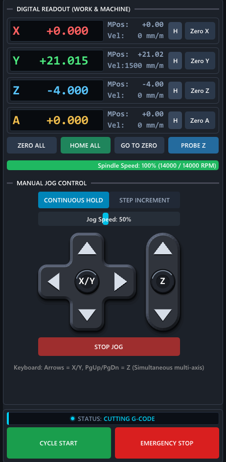

- Each axis shows the **work position** (large, relative to the active work offset), the **machine position** (MPos)
  and the current speed.
- **Zero X / Y / Z / A** sets the work zero of that axis at the current position (in the active work offset, G54 by
  default). **ZERO ALL** does all axes.
- **H** homes one axis, **HOME ALL** runs the homing sequence (`scripts/mill/home_all.lua`).
- **GO TO ZERO** moves to the work zero, **PROBE Z** opens the Z touch-off dialog.
- **Jog:** *Continuous Hold* moves while a button or key is held, *Step Increment* moves a fixed distance per press.
  **Jog Speed** scales the jog feed. Several axes can be jogged at once from the keyboard.
- **Limit Override** (only shown during a limit alarm) lets you jog off a triggered limit switch.
- **CYCLE START / EMERGENCY STOP** (or **RESET E-STOP** while in E-stop) at the bottom.

### Toolpath view

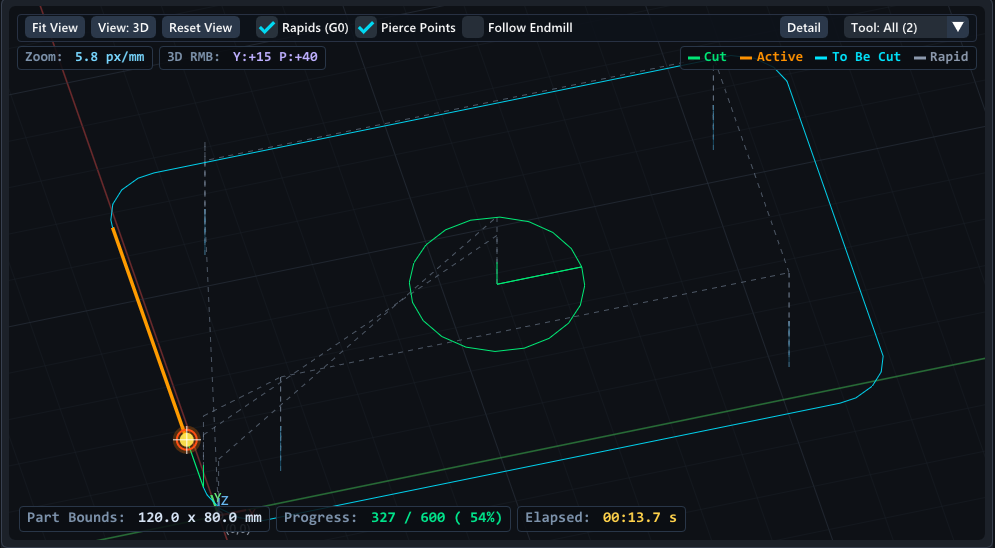

- **Mouse:** wheel = zoom, left or middle drag = pan, right drag = rotate (3D view).
- **Fit View** fits the program, **View: 2D / 3D** switches the projection, **Reset View** returns to the default angle.
- **Rapids (G0)** and **Pierce Points** show or hide rapid moves and pierce / plunge points.
- **Follow Endmill / Torch / Laser** keeps the tool in the middle of the view.
- **Detail** sets the drawing tolerance (0.5–4 px). Lower values are more exact, higher values faster on slow PCs.
  It only changes the drawing, never the machine motion.
- **Tool** shows only the moves of one tool in multi-tool programs.
- Colors: green = cut, orange = active, blue = still to cut, dashed = rapid.

### Program panel

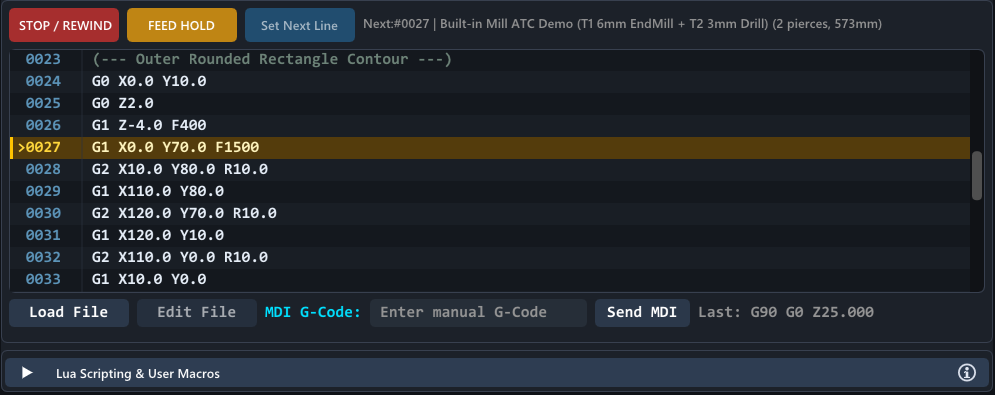

- **Load File** opens a program. You can also **drop a file onto the window** or open it with the app ("Open with" /
  double-click once the file type is associated). Large files load in the background ("Loading …" is shown).
- When a file looks like it was made for a different machine type (for example a mill program in BreakoutCut), you
  are asked before it is loaded.
- **Edit File** opens it in your text editor. When the file changes on disk, it is reloaded automatically (not while
  cutting).
- **Set Next Line**: select a line (double-click) to start or resume from there.
- **MDI G-Code**: type a command (for example `G0 X0 Y0` or `G91 G1 Z-1 F100`) and press **Send MDI**.
- **STOP / REWIND** stops the job and goes back to line 1, **FEED HOLD** pauses with a controlled stop.

## 4. Try it in the simulator

Without a board (or with **Simulator Mode** ticked in *USB Motion Controller & Connection*), everything works except
real motion. A demo program is loaded the first time.

1. Press **RESET E-STOP**.
2. Press **CYCLE START**. The toolpath view shows the progress, the program listing follows the active line.
3. BreakoutMill's demo stops at the first tool change (M6) and asks you to insert tool T1:

   

   Choose **T1 already probed** to continue without probing (in the simulator there is nothing to probe).
4. Try **FEED HOLD**, the feed override buttons, jogging and MDI commands while it runs.

The inputs in the bottom strip (IN1–IN8) can be clicked to simulate switches: for example a limit switch, the
probe, or the laser interlocks in BreakoutCut.

## 5. Set up a new machine

> Coming from Mach3? Skip to [6. Migrate from Mach3](#6-migrate-from-mach3): the import fills in most of this section
> for you, then come back to check the parts it does not cover.

All machine settings are in the right column. Each section opens with a click on its header:

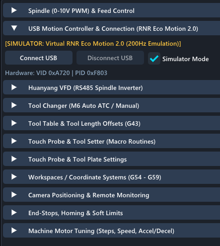

Work through them in this order, with the stepper drivers **powered off** until step 5.3 is done.

### 5.1 Connect the board

*USB Motion Controller & Connection*: with the board plugged in, untick **Simulator Mode** (or press **Connect
USB**). The yellow line changes from `[SIMULATOR …]` to the board's name. If the board is not found on Linux, check
the udev rule; on Windows no driver is needed.

### 5.2 Units and motors

*Machine Motor Tuning*:

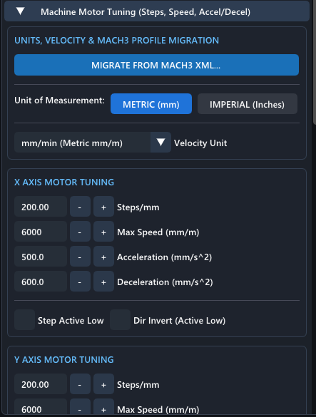

- **Unit of Measurement:** METRIC (mm) or IMPERIAL (inches). All settings and the readout follow it.
- **Steps/mm** for each axis: `motor steps per revolution × microstepping ÷ travel per revolution`. Example: a
  200-step motor, 8× microstepping on the driver, 5 mm ball screw → `200 × 8 ÷ 5 = 320` steps/mm. For a belt:
  travel per revolution = pulley teeth × belt pitch.
- **Max Speed** and **Acceleration / Deceleration:** start low (for example 3000 mm/min and 300 mm/s²) and raise them
  once everything works. If a motor stalls or loses steps, lower them again.
- **Step Active Low / Dir Invert:** if an axis moves the wrong way, tick **Dir Invert** for it. Step Active Low is
  only needed for drivers that step on the falling edge.
- **Gantry (dual motor):** at the bottom of this section the A output can follow X or Y, for a second gantry motor.

### 5.3 E-stop, limits and homing

*End-Stops, Homing & Soft Limits*:

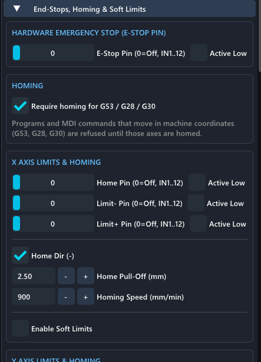

- **E-Stop Pin:** the board input of your E-stop button (0 = none). The hardwired E-stop should still cut the driver
  power directly; this input lets the software know about it.
- **Home Pin / Limit- Pin / Limit+ Pin** for each axis: board inputs IN1–IN12, 0 = not used. One switch can be used
  as both home and limit.
- **Active Low:** tick it for normally-closed (NC) switches wired to GND / COM, which trigger when the circuit opens.
  NC switches are recommended: a broken wire then triggers the switch instead of hiding it.
  **Check every input:** with nothing pressed, the bottom strip must show the input off; press the switch by hand and
  it must turn on (and the E-stop / limit alarm must appear).
- **Home Dir (-):** home towards the negative end (ticked) or the positive end.
- **Home Pull-Off:** how far the axis backs off the switch after homing. **Homing Speed:** keep it slow enough to
  stop safely when the switch triggers.
- **Enable Soft Limits** with **Min / Max** in machine coordinates: moves outside are refused before the job starts
  (only after the axis is homed).
- **Require homing for G53 / G28 / G30** (on by default): programs that move in machine coordinates are refused until
  the axes are homed. Turn it off only on a machine without home switches; machine coordinates then continue from the
  position saved when the app was last closed.

After this section: power the drivers, jog each axis slowly in both directions, check the direction and the distance
(mark a position, jog 100 mm, measure), then try **HOME ALL**.

### 5.4 Spindle and VFD

*Spindle (0-10V PWM) & Feed Control*:

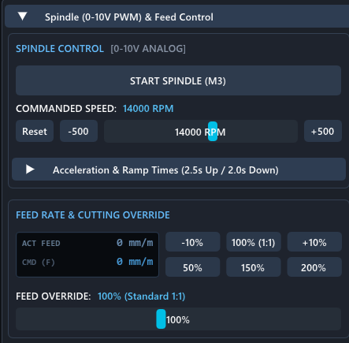

- **START SPINDLE (M3)** and the speed slider control the 0–10 V output of the board (OUT1 enables the spindle relay).
- **Acceleration & Ramp Times:** how long the spindle needs to reach speed and to stop. Programs wait this long after
  M3 before cutting.
- **Feed override:** −10 % / +10 % and the presets scale the programmed feed while a job runs.

*Huanyang VFD (RS485 Spindle Inverter)*: for a Huanyang VFD on a USB RS-485 adapter, choose the serial port
(**Refresh** lists them again) and the baud rate (it must match the VFD's PD164), then **Read Parameters from VFD**
to check the VFD's maximum frequency and speed and **Use These Values**. The live
speed, current and alarms appear in the readout; a VFD alarm stops the job. See
[the VFD protocol notes](protocol/HUANYANG_VFD_PROTOCOL.md) for the VFD-side settings.

### 5.5 Probe and tool setter

*Touch Probe & Tool Plate Settings*: the **Probe Pin** (default IN5), **Z Plate Thickness**, probe tip diameter and the
clearances used by the probing routines. Check the input: touch the plate with the tool or clip and the probe state
in *Touch Probe & Tool Setter* must change from *READY (OPEN CIRCUIT)* to *CONTACT ACTIVE (G31 HIT)*.

### 5.6 Tool changes and tool lengths

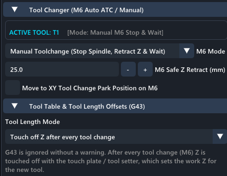

*Tool Changer* → **M6 Mode**:

- **Manual Toolchange** (default): on M6 the spindle stops, Z retracts to **M6 Safe Z Retract**, optionally moves
  to a park position, and the tool change prompt asks you to change the tool (and probe it). Cycle Start resumes.
- **Auto Toolchanger (ATC):** for machines with an automatic changer; **ATC Change Time** is how long a change takes.
- **Ignore M6:** for single-tool programs that still contain M6.

In both Manual and ATC mode the tool change itself is the Lua script `scripts/mill/m6.lua`: adapt it to your
changer or your way of working (see [10. Scripts and macros](#10-scripts-and-macros)).

*Tool Table & Tool Length Offsets* → **Tool Length Mode** says how this machine handles different tool lengths:

- **Touch off Z after every tool change:** after each M6 you touch off Z with the plate. G43 in programs is ignored.
- **Tool table (apply G43 H<n>):** each tool's length is measured once on a tool setter; G43 H<n> in the program
  applies it.
- **Not configured:** G43 is ignored and programs that use it show a warning until you choose one of the above.

### 5.7 Work offsets

*Workspaces / Coordinate Systems (G54 - G59)*: six work offsets. The active one (G54 by default) is what **Zero X /
Y / Z** sets. Programs select them with G54–G59; **Set** stores the current position in an offset.

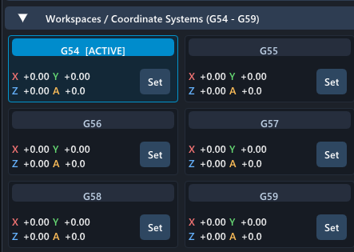

### 5.8 Final check

Before the first real job, go through the [hardware validation checklist](HARDWARE_VALIDATION_CHECKLIST.md): it
tests the E-stop paths, limits, homing, probe, outputs and the spindle step by step, starting with the drivers off.

## 6. Migrate from Mach3

If the machine ran on Mach3, the migration wizard imports its profile (the `.xml` file in the Mach3 folder) and then
walks you through a 5-stage test. Open it with **MIGRATE FROM MACH3 XML…** at the top of *Machine Motor Tuning*.

### 6.1 Import the profile

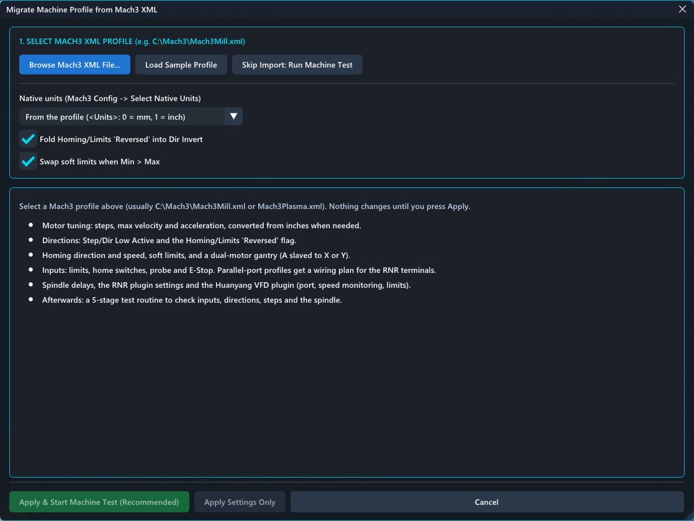

1. **Browse Mach3 XML File…** and pick the profile, usually `C:\Mach3\Mach3Mill.xml` (BreakoutMill) or
   `Mach3Plasma.xml` (BreakoutCut). Profiles found in `C:\Mach3` are offered as buttons. **Load Sample Profile** shows
   what an import looks like without a file.
2. **Native units:** normally *From the profile*. Change it only if the profile's units are set wrong in Mach3.
3. **Fold Homing/Limits 'Reversed' into Dir Invert:** Mach3 can reverse an axis in two places; BreakoutCNC has one.
   Leave it ticked.
4. **Swap soft limits when Min > Max:** fixes profiles with swapped soft limits. Leave it ticked.

What is imported:

- Motor tuning: steps per unit, maximum velocity and acceleration (converted from inches when needed).
- Step / direction polarity and the 'Reversed' flags.
- Homing direction and speed, pull-off, soft limits, and a slaved gantry axis.
- Inputs: limits, home switches, probe and E-stop. Profiles for a parallel-port breakout board get a wiring plan for
  the RNR board's terminals.
- Spindle delays, the RNR plugin's settings and the Huanyang VFD plugin's settings.

### 6.2 Check the report

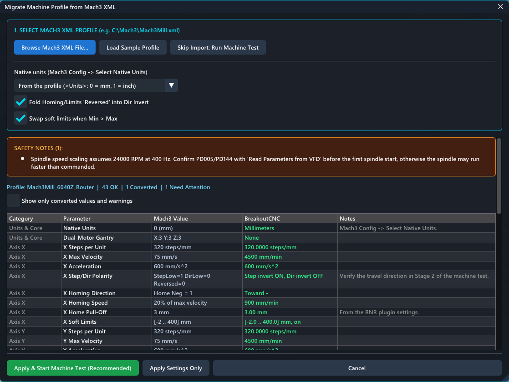

- **Safety notes** at the top need your attention before the first run (here: confirm the VFD speed scaling).
- The table lists every imported value: the Mach3 value, what BreakoutCNC will use, and notes. Values marked
  *Converted* were changed (for example from inches); *Need Attention* rows are worth checking.
- Tick **Show only converted values and warnings** to shorten the list.
- Nothing changes until you press **Apply & Start Machine Test (Recommended)** or **Apply Settings Only**.
  **Cancel** keeps your current settings.

### 6.3 The machine test

**Apply & Start Machine Test** applies the settings and opens the test. Until you press **Save Settings & Close**,
**Cancel (Restore Previous Settings)** (or closing the window) undoes the whole import.

1. **Pin Polarity Sanity:** with nothing pressed and the E-stop released, every input must read *CLEAR*. An input that
   reads *TRIGGERED WHILE IDLE* has the wrong polarity: press **Invert Polarity**.

   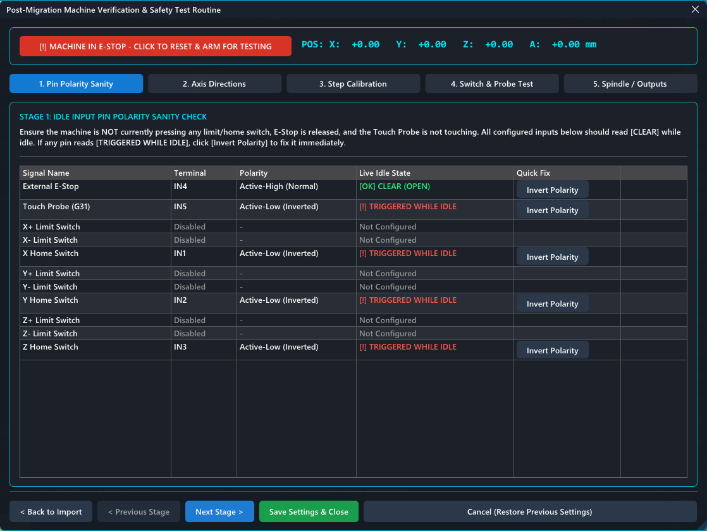

2. **Axis Directions:** with the drivers on, nudge each axis a short distance at low speed, Z first (+Z must move
   up, away from the table). If an axis moves opposite to the button you pressed, click **Flip Direction & Re-Test**.
   For a slaved gantry, check that both motors turn the same way.
3. **Step Calibration:** zero the axis, move a test distance, measure the real travel with a ruler or dial indicator
   and enter it. **Apply Calibrated Steps** corrects steps/mm; **Distance Matches Exactly** marks it as verified.

   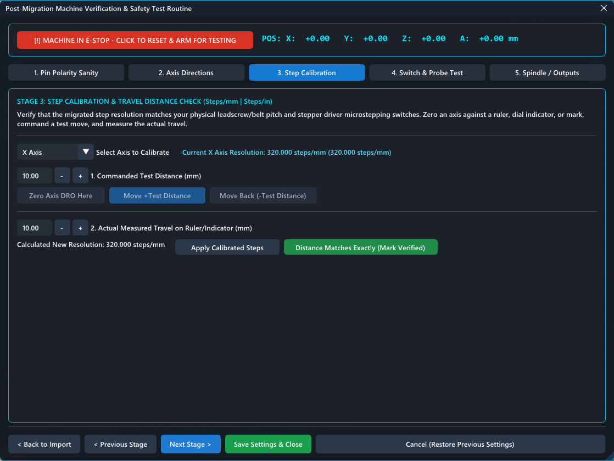

4. **Switch & Probe Test:** press every limit and home switch and touch the probe by hand; each must show as
   triggered.
5. **Spindle / Outputs:** switch the outputs (OUT1–OUT4) and run the spindle briefly to check the relays and the
   speed.

The red bar at the top resets the E-stop for testing and is an E-stop button while moving (Esc works too).

Not imported from Mach3: screen sets, brains, macros (`M*.m1s`) and plugin-specific features other than the RNR and
Huanyang plugins. Rewrite Mach3 macros as Lua scripts (see [10. Scripts and macros](#10-scripts-and-macros));
BreakoutCNC also accepts common Mach3 script calls (`Code`, `GetDRO`, `SetDRO`, `Sleep`).

## 7. Run a job

1. **Home** the machine (**HOME ALL**), if it has home switches.
2. **Load** the program (Load File, drop it on the window, or open it with the app). Check the toolpath and the part
   size (*Part Bounds*) in the view.
3. **Set the work zero:** jog to the zero point of the workpiece and press **Zero X / Zero Y**. For Z, use **PROBE Z**
   with the touch plate (or jog down to the surface and press **Zero Z**).
4. Check the spindle speed: most programs start the spindle themselves (`M3 S…`); the spindle slider and the
   override change it live.
5. Press **CYCLE START**. During the job:
   - **FEED HOLD** pauses; **CYCLE START** continues.
   - **STOP / REWIND** ends the job and goes back to line 1.
   - Feed override changes the speed live.
   - At a tool change (M6) the job waits; change the tool, touch off if needed, then **CYCLE START** (or *Resume M6*).
6. To restart in the middle, select a line, press **Set Next Line**, then **CYCLE START**. If the spindle is off you
   are asked whether to start it first.

The *Progress* and *Elapsed* readouts in the toolpath view show how far the job is.

## 8. Probing

*Touch Probe & Tool Setter (Macro Routines)* in BreakoutMill:

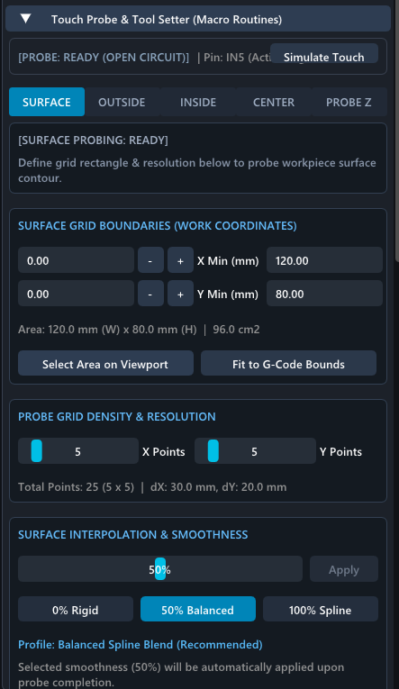

- **PROBE Z:** touch off Z on the plate (the plate thickness is subtracted).
- **OUTSIDE / INSIDE / CENTER:** find edges and corners, the center of a bore, a boss, a slot or a web. Enter the
  approximate sizes so the routine knows how far to move.
- **SURFACE:** probes a grid over the workpiece (for example a warped board for engraving or PCB milling) and warps
  the toolpath to follow the measured surface. Choose the area (or **Fit to G-Code Bounds**), the number of points
  and the smoothing, then **START SURFACE PROBING**. The compensation can be cleared again.
- **Simulate Touch** triggers the probe input in the simulator.

The routines are Lua scripts in `scripts/` and can be adapted.

## 9. BreakoutCut: plasma and laser

BreakoutCut switches between **PLASMA** and **LASER** in the title bar; the settings column changes with it. The
built-in demo program follows the mode.

### Plasma

- *Plasma Torch & Process Control:* manual torch firing, **Dry-Run Mode** (traces the path with the torch off), the
  floating-head Z touch-off and the pierce delay override.
- *Torch Height Control (THC):* real-time Z tracking from the THC's up / down signals, **Wait Arc OK** (motion waits
  for the arc-OK input after firing), anti-dive at corners, THC speed and Z limits. The **Sim Test** buttons simulate
  arc OK and up / down in the simulator.
- *Ohmic Sense & Floating Head (IHS / Probe):* initial height sensing before each pierce.

Plasma programs from SheetCam and similar CAM programs use M3 / M5 to fire the torch and G4 for the pierce delay.

### Laser

- *Laser Source & Power Control:* source type presets, **Dynamic Laser Power (M4)** (power follows the speed, so
  corners do not burn), **Ignore G-Code Z Moves** (fixed focus height), min / max duty and the live power override.
  Programs use `S0`–`S1000` for 0–100 % power.
- *Laser Alignment, Pulse & Framing:* **FRAME JOB BOUNDING BOX** traces the job outline, so you can position the
  material: with a low-power beam, the red-dot pointer (OUT2), both, or motion only. **Test Fire** gives a short pulse
  for focusing.
- *Air Assist & Auxiliary Outputs:* air assist (automatic with the laser, with pre- and post-flow), exhaust fan.
- *Laser Safety Interlocks:* the laser only fires when the chiller flow (IN2 by default), the door / lid (IN3) and
  the laser PSU fault input (IN4) are all OK. Set an input to 0 to disable that interlock. In the simulator, click
  IN2 and IN3 in the bottom strip to close them.

## 10. Scripts and macros

The *Lua Scripting & User Macros* panel (below the program) runs Lua 5.4 scripts and holds user macro buttons.
Scripts drive tool changes (`scripts/mill/m6.lua`), homing (`home_all.lua`), probing and custom M-codes (for example
`scripts/macros/M100.lua` runs on `M100`). They can move the machine, read inputs, show dialogs and ask the operator
questions. The full API, with examples, is in [SCRIPTING_ENGINE_SPEC.md](architecture/SCRIPTING_ENGINE_SPEC.md) and in
the built-in guide (the ⓘ button in the panel).

## 11. Remote monitoring

*Camera Positioning & Remote Monitoring* (BreakoutMill) / *Remote Webcam Monitoring* (BreakoutCut): a camera can be
shown under the toolpath (with calibration so the toolpath lines up with the workpiece), and a small web server can
stream it (`http://<pc>:8080/stream` by default) together with the job state and a remote E-stop.

> The web server has **no password**: enable it only on a network you trust. Uploading G-code from the browser is a
> separate option and off by default.

## 12. Troubleshooting and getting help

| Problem | What to check |
|---|---|
| Nothing moves, "E-STOP" shown | Press **RESET E-STOP**. If it does not reset, an E-stop or limit input is active (see the bottom strip and the message). |
| Program refused: "uses machine coordinates … not homed" | Home the machine, or untick *Require homing* on machines without home switches. |
| An input shows as active while nothing is pressed | Wrong polarity: toggle its **Active Low** box (or use *Invert Polarity* in the machine test). |
| An axis moves the wrong way | Tick **Dir Invert** for that axis in *Machine Motor Tuning*. |
| Wrong distance | Check steps/mm (and the driver's microstepping switches); use stage 3 of the machine test. |
| "G43 tool length offsets are ignored" warning | Choose a **Tool Length Mode** (section 5.6). |
| Board not found on Linux | Add the udev rule from the README, unplug and replug the board. |
| macOS: "app is damaged / cannot be opened" | Run `xattr -dr com.apple.quarantine <folder>` once. |
| Slow on an older PC | Raise **Detail** in the toolpath toolbar; press F12 to see where the time goes. |

**Reporting a problem:** tick **Diagnostics** in the bottom-right corner. The report window shows the version, OS,
graphics, board state and a few key settings (no file paths or serial numbers); press **Copy to clipboard** and paste
it into a [new issue](https://github.com/rolanddd-hu/BreakoutCNC/issues/new/choose).

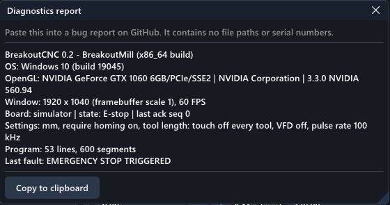

For performance problems, start the app with the environment variable `BREAKOUTCNC_PERF_LOG=<file>`: it writes the
F12 overlay's numbers to that file once per second, which you can attach to the issue.
